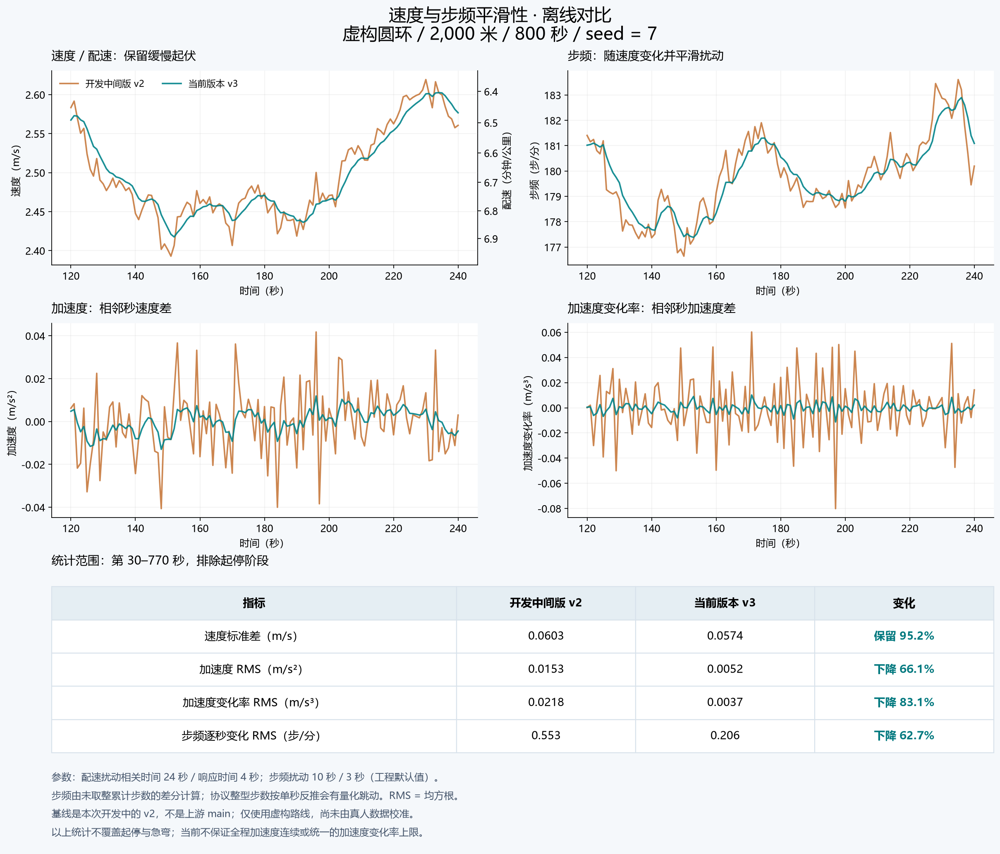

# 速度与步频平滑性对比



本图比较本次开发中的 `motion-v2` 中间版本与当前 `motion-v3`，**不是与上游 `main` 的对比**。两组记录都来自 `motion-check` 默认虚构圆环，距离 2000 米、时长 800 秒、随机种子 7；不包含个人轨迹或地图坐标。

曲线展示第 120–240 秒，统计覆盖第 30–770 秒，排除首尾各 30 秒。步频由未取整累计步数计算：`60 × (steps[t] - steps[t-1])`。协议累计步数最终取整，按一秒窗口反推会出现量化跳动。

| 指标 | 开发中间版 v2 | 当前 v3 | 变化 |
| --- | ---: | ---: | ---: |
| 速度标准差（m/s） | 0.06029 | 0.05738 | 保留 95.2% |
| 加速度均方根（m/s²） | 0.01534 | 0.00519 | 下降 66.1% |
| 加速度变化率均方根（m/s³） | 0.02178 | 0.00369 | 下降 83.1% |
| 步频逐秒变化均方根（步/分） | 0.55289 | 0.20628 | 下降 62.7% |

配速扰动的目标相关时间为 24 秒、响应时间为 4 秒；步频扰动分别为 10 秒和 3 秒。这些是工程默认值，尚未使用真人原始记录校准。图中统计不验证起停或急弯，也不意味着全程加速度连续或服务端认可记录。

## 复现图表

`synthetic-motion-v2.json` 保存了平滑修改前的开发中间版输出；`synthetic-motion-v3.json` 保存当前版本输出。两个文件只保留模型、种子、时长、距离误差和时间/距离/速度/未取整步数序列。`comparison-metrics.json` 包含完整精度的统计结果。

安装 Python 的 `matplotlib` 和 `numpy`，并使用 Microsoft YaHei、Noto Sans CJK SC 或 SimHei 字体，然后在仓库根目录运行：

```sh
python tools/plot_motion_comparison.py --before docs/motion-model/synthetic-motion-v2.json --after docs/motion-model/synthetic-motion-v3.json --output-dir docs/motion-model
```

该命令生成 PNG、SVG 和统计 JSON。当前模型的原始离线输出可另行生成：

```sh
cargo run --locked --no-default-features -- motion-check --timeline > motion-v3.json
```

该离线命令不加载账号配置，不登录，也不提交活动。图表使用一秒间隔的有限差分：加速度为相邻速度差，加速度变化率为相邻加速度差；标准差采用总体标准差，RMS 为均方根。
